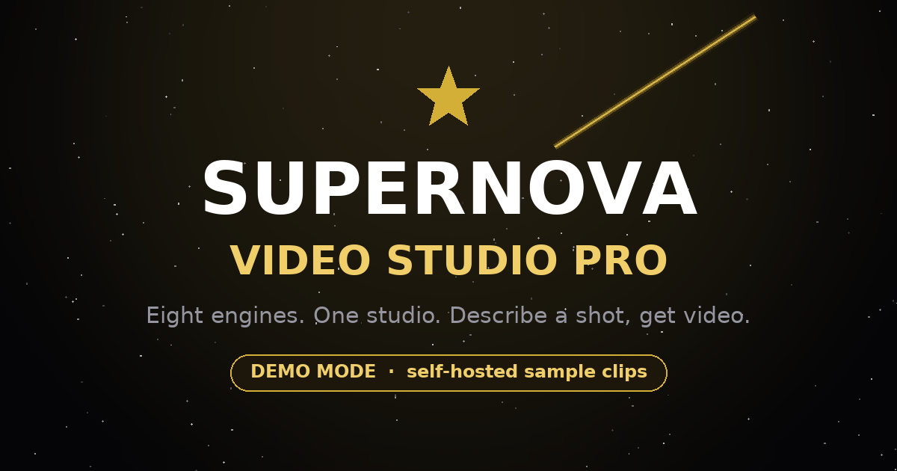

# Supernova Video Studio 🚀

### Multi-engine AI video studio — by SupernovaSolutionsHQ

[](https://github.com/rafikche336-tech/supernova-video-studio-pro/actions/workflows/ci.yml)
[](./LICENSE)
[](https://nextjs.org)
[](https://nodejs.org)



---

## ⚠️ Status: demo mode (read this first)

**The interface, the API and the job pipeline are real. The video model is not.**

In the default `demo` mode the studio returns **short, original, procedurally
generated clips** that it hosts itself — not model output. The UI says so with a
visible banner, and the API reports `"mode": "demo"` on every response.

There is **no Wan 2.2 / Mochi 1 / SVD / OpenShorts inference code in this
repository** and no model weights. Those names identify the engine profiles the
UI is built to host. To make generation real, implement one interface —
[`RenderProvider`](lib/render/types.ts) — and point the app at your backend:
see [docs/ARCHITECTURE.md](docs/ARCHITECTURE.md#plugging-in-a-real-model).

We would rather ship an honest demo than a convincing fake. If you deploy this
publicly, keep the demo banner on until real inference is wired up.

---

## ✨ What works today

- **Eight engine cards** — collapsible, keyboard-accessible, per-card prompt form.
- **Real job lifecycle** — `POST /api/render` returns `202` with a job id; the UI
  polls until `succeeded`. Cancellable, with progress, error and retry states.
- **Six languages** (EN · AR · FR · ES · DE · ZH) with full typing, automatic
  `lang`/`dir` switching and genuine RTL for Arabic.
- **Hardened API** — schema validation, engine allow-list, prompt/body caps,
  per-client rate limiting, typed error mapping, structured logs.
- **Self-hosted media** — six 3-second H.264 clips (~470 KB total) generated by
  [`scripts/generate-demo-clips.py`](scripts/generate-demo-clips.py). Same-origin,
  so downloads and CSP work without exceptions.
- **Accessibility** — real buttons, labels, live regions, visible focus rings,
  reduced-motion support, skip link.
- **Quality gates** — 41 unit tests, 57 end-to-end checks, typecheck, ESLint,
  Prettier and a dependency audit, all in CI.

## 🚀 Quick start

```bash
# Node.js ≥ 20.9 (22 LTS recommended)
npm ci            # reproducible install from the committed lockfile
npm run dev       # http://localhost:3000
```

No API keys, no GPU, no `.env` needed — demo mode is the default.

Production build:

```bash
npm run build
npm start
```

## 🧭 Scripts

| Script                            | What it does                                                               |
| --------------------------------- | -------------------------------------------------------------------------- |
| `npm run dev`                     | Dev server with hot reload                                                 |
| `npm run build` / `npm start`     | Production build / serve                                                   |
| `npm run typecheck`               | `tsc --noEmit` with `strict` + `noUncheckedIndexedAccess`                  |
| `npm run lint`                    | ESLint 9 flat config (non-interactive, CI-safe)                            |
| `npm run format` / `format:check` | Prettier write / verify                                                    |
| `npm test`                        | Vitest unit suite (41 tests)                                               |
| `npm run test:integration`        | Boots `next start` and probes it (57 checks) — needs `npm run build` first |
| `npm run verify`                  | typecheck → lint → test → build                                            |
| `npm run audit:ci`                | Dependency audit gate                                                      |
| `npm run media:generate`          | Regenerate the demo clips (needs Python + ffmpeg)                          |

## 🏗️ Architecture

```
app/
  layout.tsx            server · metadata, OG, viewport
  page.tsx              server · static shell + no-JS fallback
  error / loading / not-found / robots / sitemap
  api/render/route.ts           POST create job · GET capabilities
  api/render/[id]/route.ts      GET poll job
  globals.css                   tokens + base styles (plain CSS)

components/             client islands + CSS Modules
  StudioApp · EngineCard · LanguagePicker · StarfieldCanvas · VideoPreview

hooks/
  useRenderJob.ts       POST + poll state machine (cancellable)
  useStarfield.ts       DPR-aware canvas animation

lib/
  engines/registry.ts   single source of truth: engines, clips, ids
  engines/pick-clip.ts  prompt → clip mapping (shared by API + UI)
  render/               types · schema (zod) · provider · job store
  i18n.ts               six typed dictionaries
  env.ts · config.ts · logger.ts · rate-limit.ts
```

Full detail, including how to plug in a real model: [docs/ARCHITECTURE.md](docs/ARCHITECTURE.md).

## 🔌 API

```bash
# capabilities
curl localhost:3000/api/render

# create a job
curl -X POST localhost:3000/api/render \
  -H 'content-type: application/json' \
  -d '{"prompt":"a cinematic ocean at sunset","engine":"wan"}'
# → 202 { "job": { "id": "...", "status": "queued", ... }, "mode": "demo" }

# poll it
curl localhost:3000/api/render/<job-id>
```

Complete reference — schemas, every status code, limits: [docs/API.md](docs/API.md).

## ⚙️ Configuration

Validated at startup in [`lib/env.ts`](lib/env.ts); copy [`.env.example`](.env.example).

| Variable                       | Default                 | Purpose                                          |
| ------------------------------ | ----------------------- | ------------------------------------------------ |
| `RENDER_PROVIDER`              | `demo`                  | `demo` = generated clips · `live` = your backend |
| `RENDER_API_URL`               | —                       | Required for `live`                              |
| `RENDER_API_KEY`               | —                       | Required for `live`; never sent to the browser   |
| `NEXT_PUBLIC_SITE_URL`         | `http://localhost:3000` | Canonical URL for metadata, OG, sitemap          |
| `RATE_LIMIT_CAPACITY`          | `12`                    | Burst budget per client                          |
| `RATE_LIMIT_REFILL_PER_SECOND` | `0.2`                   | Sustained rate (12/min)                          |

## 🧪 Testing

```bash
npm test                     # unit
npm run build && npm run test:integration   # end-to-end against a real server
```

The integration suite asserts the things that used to be broken: malformed JSON
must be `400` (not `200`), `{"engine":"__proto__"}` must be `422` (not a leaked
`Object.prototype`), oversized prompts must be `413`, security headers must be
present, and a job must reach `succeeded` with a playable, same-origin clip.

## 🚢 Deployment

Works on Vercel or any Node 20.9+ host.

1. Set `NEXT_PUBLIC_SITE_URL` to your real origin (metadata/OG/sitemap use it).
2. Leave `RENDER_PROVIDER=demo` until you have a backend.
3. **Job state is in memory** — a multi-instance deployment needs Redis or a
   database, otherwise polling can hit an instance that has never seen the job.
   This is documented in [docs/ARCHITECTURE.md](docs/ARCHITECTURE.md#scaling).

## ⚠️ Known limitations

- Demo rendering only; `live` mode returns `501` by design instead of faking it.
- Rate limiting is per-process (see [SECURITY.md](SECURITY.md#known-limitations)).
- No authentication — add it before exposing a paid backend.
- Locale switching is client-side; the initial HTML is English.

## 🤝 Contributing

See [CONTRIBUTING.md](CONTRIBUTING.md). Security reports: [SECURITY.md](SECURITY.md).

## 📄 License & credits

Code: **MIT** ([LICENSE](./LICENSE)). Demo clips: original, generated by this
repository, released **CC0**. Details: [THIRD_PARTY_NOTICES.md](./THIRD_PARTY_NOTICES.md).

العربية: [README.ar.md](./README.ar.md) · Built in Algeria 🇩🇿 by SupernovaSolutionsHQ.
